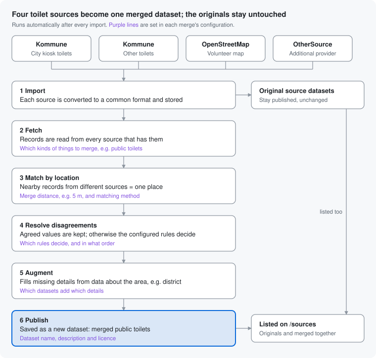
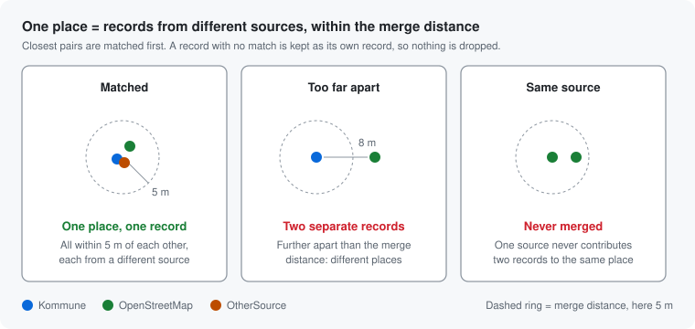
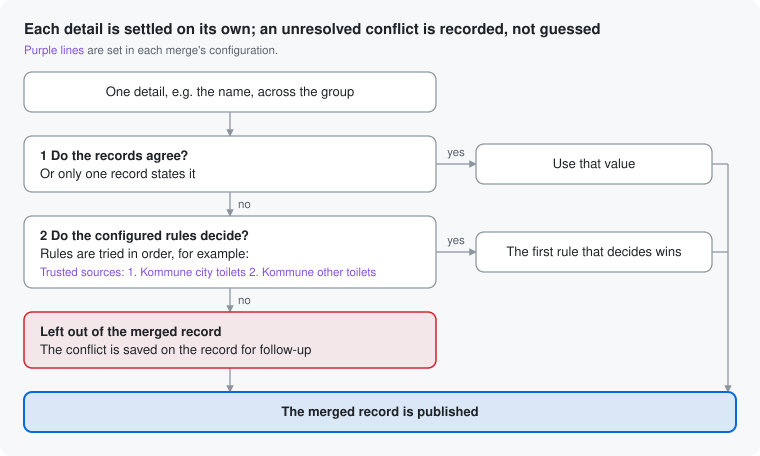
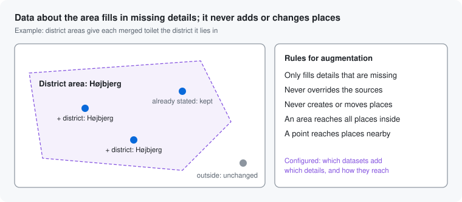
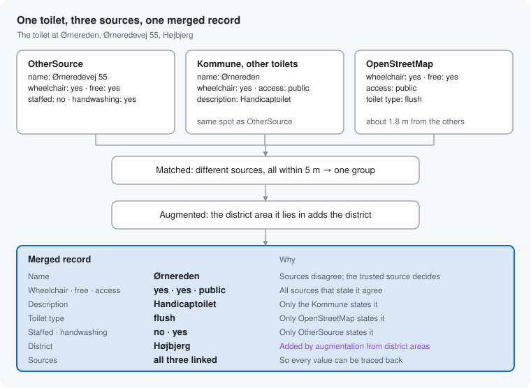

# How conflation works

The same entity (i.e. public toilet) is often described by several data sources, each with different details.
Conflation finds the records that describe the same place and combines them into one record. The result is
published as a new, separate dataset; the original datasets are not changed.

Public toilets are used as the example throughout, merged from four sources. The same process applies to any kind of
place, such as benches or parking spaces, each with a configuration of its own.

## At a glance

Because the sources stay published next to the merged dataset, every merged value can be traced back to where it came
from, and a bad merge is fixed by running conflation again.

## What each merge configures

Each kind of place has its own merge configuration. It decides how the steps above behave, so a new kind of place, a
stricter distance or another order of trusted sources is a change of configuration, not a change of the process.

| Setting             | What it controls                                                       | Example: public toilets                                                 |
|---------------------|------------------------------------------------------------------------|-------------------------------------------------------------------------|
| Kinds of things     | Which records are merged, and what the merged record is                | Public toilets                                                          |
| Merge distance      | How close records from different sources must be to count as one place | 5 metres                                                                |
| Matching method     | How records are paired; replaceable for kinds that need other rules    | Closest pairs first, one record per source                              |
| Conflict rules      | Which rules settle a disagreement, and in what order                   | Trusted sources: Kommune city toilets first, then Kommune other toilets |
| Augmenting data     | Which datasets about the surroundings add which details                | District areas add the district                                         |
| Augmentation method | How data about the surroundings reaches places                         | An area reaches every place inside it; a point, places nearby           |
| Dataset details     | The merged dataset's name, description and licence                     | "Offentlige toiletter (samlet), Aarhus Kommune"                         |

## How records are matched

Matching uses location only: names, categories and other details play no part in deciding whether two records are the
same place.

- Records from different sources that are closer than the **merge distance** are treated as the same place.
- Every record in a group must be within the merge distance of every other record, so a row of nearby places is not
  collapsed into one.
- The closest pairs are matched first, and the result is the same every time.
- A record with no match becomes a merged record of its own. Nothing is dropped.

## When sources disagree

Each detail, such as the name or the address, is settled separately. A detail that only one source states is always
kept. When sources disagree, the configured rules decide, typically a fixed order of trusted sources. A disagreement
no rule settles is never guessed: it is saved on the record so it can be corrected at the source.

## Adding details from the surroundings

Some datasets do not describe the places themselves but say something about where they are: district areas, ground
cover, parking zones. Augmentation lets such data add details to the merged records. A district area gives every
toilet inside it its district; an area of asphalt gives every parking space on it its surface.

This data never becomes a place of its own, and it never overrides what the sources themselves state.

## Worked example: the toilet at Ørnereden

The three records lie within 1.8 m of each other and come from three different sources, so they form one group. Most
details agree or are stated by only one source. The names disagree, so the trusted source order decides: the Kommune
name wins. Finally, the district area the toilet lies in adds its district.

## Background

The design is described in these architecture decision records:

- [ADR 004: Conflation pipeline](adr/004-conflation-pipeline.md)
- [ADR 005: Merge by location](adr/005-conflation-merge-by-location.md)
- [ADR 006: Conflict resolution](adr/006-conflation-conflict-resolution.md)
- [ADR 007: Augmentation](adr/007-conflation-augmentation.md)
